# Kaze (風) — standalone prototype

> **This crate is not the product.** The Kaze that ships is
> `crates/sofuu-core/src/domains/kaze/`, compiled into the `sofuu` binary and
> described in the Sofuu workspace's local `docs/KAZE-SPEC.md` (language v0.1,
> frozen). This directory is an earlier, standalone prototype with its own
> workspace, CLI and test suite; `make` and CI never build it.
>
> The two surfaces have diverged. The prototype carries eleven vector/trig
> opcodes (`VecNew` through `VecSlantDist`, including `Atan2`), three
> fault-tolerance opcodes (`TryBegin`, `TryEnd`, `LinkLost`), compile-time
> modules (`use "…"`), the v0.6 tooling (`kaze fmt`, `kaze-lsp`, the VS Code /
> Cursor extension), the v0.7 verifier and fuzzers, the v0.8 mission
> benchmarks, and the frozen v1.0 spec, standard library and certification
> scorecard. It calls itself **v1.0**; the separately implemented engine in
> the product reports v0.1 and has a different surface and bytecode format.
> `scripts/kaze-drift-check.sh` (run by `make test`) keeps that honest: do not
> treat anything in this README as a description of the shipped runtime.
>
> **Current standalone source:** Capability calls require an explicit
> grant and a valid `policy.json`. Unavailable AI, tool, memory, sensor, and
> alert backends return errors. Drone/rover simulation is explicit and labelled
> for testing. Some examples below illustrate planned behavior; see the
> [tagged 1.0 reference](docs/KAZE-1.0-REFERENCE.md) for current support.
> Live drone actuation is disabled until the required 1.5-second heartbeat and
> per-field telemetry freshness checks are implemented. Physical hardware has
> not been verified in this working tree.

The [roadmap](docs/ROADMAP.md) tracks the remaining safety and compatibility
work and the proposed upgrades after it.

[](https://github.com/sofuu-runtime/kaze/actions)
[](LICENSE)
[](Cargo.toml)
[](#memory-model)
[](#bytecode-isa)

> **The ultra-friendly, Rust-secured scripting language for AI agents, robotics, drones, and ambient edge devices.**

Kaze (風, "wind" — *the wind of [Sofuu](https://sofuu.xyz)*) delivers **all of Rust's security, determinism, and zero-GC performance, paired with the effortless, human-readable scripting experience of Python.**

---

## 🌪️ Why Kaze?

Modern autonomous AI agents and edge robotics face a fundamental execution dilemma:
* **For AI Agents:** Writing multi-step decision and tool logic in Python or JavaScript is broken. Python's ambient I/O (`os`, `subprocess`, `open`) requires heavy Docker/gVisor sandboxes to prevent prompt injection or disk wiping. JavaScript suffers from async/await race conditions and unhandled Promise rejections. Furthermore, chaining 5 tools currently takes 5 slow, expensive LLM round-trips over JSON.
* **For Robotics & Physical Systems:** Python's non-deterministic garbage collection (stop-the-world pauses) causes actuator stutter or vehicle crashes in 10 Hz control loops. Rust provides bare-metal speed, but forces developers and LLMs to fight borrow checkers, lifetime annotations (`'a`), and verbose error handling just to script a simple patrol mission.

**Kaze solves both as a dual-pillar domain scripting language hand-rolled in pure Rust.**
1. **For AI Agents:** A natural-language execution substrate where LLMs can generate multi-step tool logic, data processing, and guardrails with zero syntax errors, zero container overhead, and fuel-bounded execution.
2. **For Robotics & Drones:** Hard real-time determinism, zero GC stutter, first-class physical units, and capability-isolated hardware control.

---

## ⚡ The Six Doctrines

1. **Natural Phrasing, Zero Syntax Friction:** Designed for effortless human auditability and zero-shot LLM synthesis. Clean natural English phrasing (`needs: memory, tools`, `if x > 10: ... otherwise: ...`) compiles into strict bytecode without indentation traps or missing imports.
2. **First-Class Substrate for AI Agents:** Agents can synthesize a single Kaze script to execute multi-tool pipelines and conditional logic locally in <1ms, replacing 5 sequential JSON chat completions with one deterministic atomic turn.
3. **Physical Unit Tokens:** Units like `meters`, `m/s`, `degrees`, `seconds`, `ms`, and `%` are accepted. The current checker does not reliably reject mismatched units; see the tagged reference.
4. **Zero Ambient I/O (Structural Capability Security):** Kaze scripts have **zero built-in side-effects**. No ambient filesystem, clock, networking, or child processes. Every external effect requires an explicit `needs: ...` declaration and crosses a strict capability gate.
5. **Deterministic by Construction (Zero GC Pauses):** Memory is sequentially allocated in a linear arena per run and reclaimed wholesale in one instant operation. There is zero garbage collector, zero stop-the-world stutter, and zero heap fragmentation.
6. **Fuel-Bounded Always:** Every instruction decrements a fuel meter. Runaway loops or runaway math halt uncatchably and return a typed `E_TIMEOUT`. A Kaze script cannot hang a drone, freeze a rover, or stall an agent.

> For a deep architectural breakdown of zero-GC memory allocation, inter-tick reclamation, and the strict two-tier error handling model, see [`docs/RELIABILITY-AND-MEMORY.md`](docs/RELIABILITY-AND-MEMORY.md).

---

## 🗺️ System Architecture

```mermaid
flowchart LR
    subgraph Frontend["Language Front-End"]
        SRC[".kaze Source Code<br/>(Natural English syntax, units)"]
        LEX["Lexer<br/>(Indentation-aware, tabs refused)"]
        PARSE["Parser<br/>(Unit normalization, verbs)"]
        CHECK["Semantic Checker<br/>(Declared capabilities, filter termination)"]
    end

    subgraph CompilerVM["Compiler & Execution Engine (crates/kaze)"]
        COMP["Compiler<br/>(47 opcodes, fused JEQ/JNE, TRY_BEGIN)"]
        BC[".kazebc Bytecode Module<br/>(Deterministic 4-byte ISA)"]
        VM["Arena VM<br/>(Instruction fuel bounds, deadline interrupt)"]
    end

    subgraph SafetyGate["Hardware Safety Gate"]
        GATE_CAP["CALL_CAP Gate<br/>• H-1: E_CAP_UNDECLARED<br/>• H-2: E_CAP_MISSING<br/>• H-3: E_CAP_DENIED<br/>• H-4: E_KAZE_RANGE"]
        ACT["Actuators / Flight Controller / Sensors"]
    end

    SRC --> LEX --> PARSE --> CHECK --> COMP --> BC --> VM
    VM --> GATE_CAP --> ACT
```



---

## 📖 Language Tour by Example

### 1. Aerial Robotics & Drone Missions (`patrol.kaze`)
```kaze
needs: drone, log

action patrol(points):
    log "Starting automated perimeter patrol"
    
    arm drone
    takeoff to 15 meters
    
    for each point in points:
        fly to point at 15 meters
    
    return to launch

when battery < 20%:
    log warning "Battery critical! Returning home immediately"
    return to launch
```

### 2. Ground Robotics & Rovers (`rover.kaze`)
```kaze
needs: rover, lidar, log

every 100ms:
    let front = lidar.front_distance()

    if front < 0.5 meters:
        log warning "Obstacle detected ahead! Turning right"
        stop rover
        turn right by 90 degrees
    otherwise:
        drive forward at 1.2 m/s
```

### 3. Smart Devices & Ambient IoT (`greenhouse.kaze`)
```kaze
needs: sensor, fan, mister, alert

check climate(target_temp, target_humidity):
    if sensor.temperature() > target_temp + 2:
        turn on fan
        send alert "Cooling fan activated"
    otherwise:
        turn off fan

    if sensor.humidity() < target_humidity:
        pulse mister for 5 seconds
```

### 4. AI Agent Guardrails & Memory Filters (`guardrail.kaze`)
```kaze
needs: memory, policy

filter user_prompt(prompt):
    if length of prompt > 2000:
        reject with "Prompt exceeds maximum allowed length"

    if policy detects secrets in prompt:
        reject with "Prompt contains private API keys or credentials"

    remember prompt as "last_valid_query"
    allow prompt
```

### 5. Autonomous AI Agent Decision Logic (`agent_pipeline.kaze`, planned illustration)
This illustration includes unsupported syntax and unavailable standalone AI,
tool, and memory backends; it is not an executable current example.
```kaze
needs: memory, tools, alert, policy

action process_lead(lead):
    # Safe semantic/structured recall with zero injection risks
    let history = recall lead.company_name

    if history is nothing:
        let enriched = tools.enrich_company(lead.domain)
        save lead.company_name: enriched

        # Deterministic multi-step reasoning executed in a single atomic turn
        if enriched.revenue > 1000000 and lead.employees > 50:
            tools.create_crm_deal(lead.id, "enterprise")
            alert "Qualified enterprise lead: " + lead.company_name
        otherwise:
            tools.tag_lead(lead.id, "nurture")
    otherwise:
        log "Existing lead already processed"

when token_budget > 90%:
    alert warning "Agent session token budget threshold reached"
```

---

## 🛠️ CLI Quickstart

Install the standalone `kaze` CLI using Cargo:

```bash
cargo install --path .
```

### Run a Script

For capability calls, place a policy such as the following in `policy.json` in
the working directory. An empty deny list leaves declarations and grants as the
caller-controlled boundary; add deny rules appropriate to your environment.

```json
{"deny": []}
```

```bash
# Explicitly labelled drone simulation for testing
kaze run examples/patrol.kaze --cap drone=sim --cap log --arg 'points=[1, 2, 3]'
```

### Verify & Typecheck (Front-End Only)
```bash
kaze check examples/patrol.kaze
# Output: ✓ examples/patrol.kaze is valid
```

### Compile to Standalone Bytecode (`.kazebc`)
```bash
# Emit deterministic bytecode module
kaze compile examples/patrol.kaze -o patrol.kazebc

# Inspect disassembled bytecode instructions
kaze compile examples/patrol.kaze --disasm

# Execute directly from bytecode without parsing
kaze run patrol.kazebc --cap drone=sim --cap log --arg 'points=[1, 2]'
```

### Live Hardware (v0.2)
A configured device can use real hardware paths, but live drone actuation is
currently disabled pending freshness checks. An unavailable backend is refused;
simulation requires an explicit testing selection and is limited to drone/rover
families.

```bash
# Live drone examples below are disabled until freshness checks are implemented
# UDP would bind this endpoint and reply to whoever speaks first
kaze run examples/patrol.kaze --cap drone=udp:127.0.0.1:14550 --cap log --arg 'points=[1, 2]'

# A serial flight controller (build with --features uart)
kaze run examples/patrol.kaze --cap drone=uart:/dev/ttyAMA0@57600 --cap log --arg 'points=[1, 2]'

# Real GPIO lines, named by the operator
kaze run your-device.kaze --cap device=gpio --pin fan=17 --pin mister=27

# Real PWM: name a channel as chip:channel, then set a duty cycle
kaze run your-device.kaze --cap device=gpio --pwm fan=0:0
```

```kaze
needs: fan

action main():
    turn on fan                     # relay: on or off
    device.set_duty("fan", 60)      # PWM: 60% at 50 Hz
    device.set_duty("fan", 0)       # 0% switches the channel off
```

A duty cycle outside 0-100 is refused by the range gate, not clamped: a fan
spinning at a speed nobody asked for is a safety problem, not a rounding one.

What the link does on its own: a 1 Hz HEARTBEAT, a 20 Hz receive loop on its
own thread, `MAV_CMD_SET_MESSAGE_INTERVAL` for the telemetry a flight needs,
COMMAND_LONG↔COMMAND_ACK correlation, and arming confirmed from the vehicle's
heartbeat rather than from the ACK alone. The code contains paths for arm,
takeoff, land, RTL, loiter, set-mode, and `drone.goto`, but those actuation
paths are currently disabled. Other refusals retain their cause, such as `E_COMMAND_REJECTED`,
`E_ARMING_DENIED`, `E_KAZE_LINK`, `E_KAZE_LINK_TIMEOUT`. The existing link
refuses after two seconds without received bytes; it does not yet meet the
required 1.5-second heartbeat and per-field telemetry freshness rule. Live
telemetry and link-silence readings must not be used as proof of freshness.

An earlier revision was measured against ArduCopter SITL over UDP. That result
does not verify this working tree or physical hardware.

GPIO defaults to sysfs (`/sys/class/gpio`). A board that dropped sysfs — a
Raspberry Pi 5, for instance — needs the character-device ABI:

```bash
cargo build --features chardev          # /dev/gpiochipN (GPIO v2 UAPI)
cargo build --features uart             # serial flight-controller links
cargo build --features chardev,uart     # both
```

Honest limits: the chardev path is compiled against the documented v2 UAPI and
its request layout and ioctl numbers are unit-tested, but it has not been run
against a real GPIO chip here, so its first use on a board is a check, not a
given. PWM is spelled `device.set_duty(name, percent)` — the call form; a
sentence form (`set fan to 60 percent`) is not in yet. And error line numbers
name the routine, not the call.

### Points and Bearings (v0.3)

A point is a value, so distance, bearing and offset are computed inside the
script — a mission can check its own geometry instead of asking a ground
station:

```kaze
needs: drone, log

action main():
    let home = vector(47.6000, 8.5000, 500)
    let waypoint = vector(47.6004, 8.5004, 520)
    log distance between home and waypoint        # 53.645 metres, Haversine
    log slant distance between home and waypoint  # 57.25, the climb included
    log bearing from home to waypoint             # 33.99 degrees
    log bearing to waypoint                       # from where the vehicle is now
    let offset = waypoint - home                  # points subtract to a point
    log bearing of offset                         # the offset's own heading
    log sin(30 in radians)
    log atan2(1, 1) in degrees                    # 45
```

`bearing to waypoint` reads the machine's own latitude and longitude (that is
why the script declares `drone`); the trace shows those two reads, so the
answer cannot come from nowhere. A script with no hardware declared gets a
parse error naming both fixes rather than a guess.

```bash
kaze run examples/kinematics.kaze --cap log --plain
```

* `vector(x, y, z)` makes a point, and `vector(x, y)` is a 2-D point (z = 0).
  Points add to points, a number scales one, `-p` flips one, and coordinates are
  read back either by index (`p[0]`, `p[1]`, `p[2]`) or by name (`p.x` / `p.lat`,
  `p.y` / `p.lon`, `p.z` / `p.alt`).
* `distance between a and b` is great-circle metres on the WGS84 mean sphere;
  `slant distance between a and b` adds the altitude difference.
* Three bearing forms, all degrees, 0 = north: `bearing to place` measures from
  the machine's own position, `bearing from a to b` names both ends, and
  `bearing of offset` is the compass direction of a vector.
* `length of p` is the 3-D magnitude; `sin`, `cos`, `atan2`, `sqrt` take radians;
  `<x> in radians` and `<x> in degrees` convert.
* `sqrt` of a negative number stops the run (`E_KAZE_MATH`) instead of returning
  NaN.
* A point handed to `distance between` or a bearing must be able to be a
  latitude and longitude; `vector(100, 200, 0)` is refused (`E_KAZE_RANGE`)
  rather than turned into a plausible-looking number.

Honest limits: `vector` components are not unit-checked, so mixing degrees and
metres inside one point is on you; a local offset of a few thousandths of a
degree still passes the place check because it is a valid coordinate — the
check catches unit mistakes, not intent. See
[`docs/KINEMATICS-CHECKLIST.md`](docs/KINEMATICS-CHECKLIST.md) for testing
kinematics and SITL missions.

### Fault Tolerance (v0.4)

`try ... otherwise` recovers from an operational failure — a link that is down,
a rejected command, a denied arm, a host refusal — so a mission can report it
and continue:

```kaze
needs: drone, log

action main():
    try:
        takeoff to 15 meters
    otherwise with err:
        log warning err.code        # E_KAZE_HOST
        log warning err.message
        log warning err.line
        arm drone
        takeoff to 15 meters
```

`otherwise with err:` binds the error record. It has exactly three fields:
`code` (text), `message` (text) and `line` (number). Without `with err:` the
recovery block simply runs.

**Safety and budget stops are never catchable.** `E_KAZE_RANGE`, every
`E_CAP_*` denial, `E_SAFETY_VIOLATION`, `E_TIMEOUT`, `E_KAZE_MEMORY`, type and
maths errors, and bytecode errors still stop the run. A machine that caught a
range violation and kept flying would be acting on a value it was told to
refuse. The recoverable set is exactly `E_KAZE_LINK`,
`E_KAZE_LINK_TIMEOUT`, `E_COMMAND_REJECTED`, `E_ARMING_DENIED` and
`E_KAZE_HOST`.

A link-loss failsafe is a `when` hook. Hooks run on supervisor ticks:

```kaze
needs: drone, log

when link lost for 3 seconds:
    log warning "link lost; returning to launch"
    try:
        return to launch
    otherwise with err:
        log warning err.code
```

The RTL may itself fail — the link is gone — so it is wrapped just as the
takeoff was; a failsafe that stops on that failure is not a failsafe.

`link lost for N seconds` is true once the link has been silent at least that
long, and it requires `needs: drone`. In a live run pass `--pace`, or the
supervisor will burn through its ticks in microseconds and never let three real
seconds pass. In the simulator, `--sim link_lost_after=1500` drops the link at
virtual millisecond 1500, so the hook is deterministic offline (no `--pace`
needed):

```bash
kaze run examples/fault_tolerance.kaze --cap drone=sim --cap log \
  --ticks 35 --tick-ms 100 --sim link_lost_after=0 --plain
```

Honest limits: the hook fires on every tick while the link stays lost, so write
the recovery to be idempotent (as the example does); a live host measures
silence from its receive thread, so the first evaluation after a real dropout
can be up to one tick late; the error record's `line` is the routine's line,
not yet the individual call's line; and `.kazebc` files from v0.3 (module
format 2) must be recompiled for the current format (4). The supervisor reclaims the run
arena and heap between ticks, so a hook's evaluation stays bounded; the
action/log trace is the mission record and still grows with the number of
calls, so cap it for a very long run. See
[`docs/FAULT-TOLERANCE-CHECKLIST.md`](docs/FAULT-TOLERANCE-CHECKLIST.md) for the
SITL dropout drill.

### Modules (v0.5)

`use "path.kaze"` compiles another file into the same program. Imports are a
header line, before the first item, and resolve **relative to the importing
file**; nested imports are resolved relative to their own file:

```kaze
# examples/modular/mission.kaze
use "lib/sensors.kaze"

needs: drone, log

action main():
    log "mission starting"
    arm drone
    takeoff to 10 meters
```

```kaze
# examples/modular/lib/sensors.kaze
needs: sensor, log

action report_temperature():
    log sensor.temperature()

every 100ms:
    if sensor.temperature() > 30:
        log warning "sensor is hot"
```

The compiler sees one program: `needs:` lines merge and deduplicate, and the
library's items are inlined before the importer's. `kaze compile` emits one
`.kazebc` with no imports left, so the artifact runs with no source files on the
device:

```bash
kaze compile examples/modular/mission.kaze -o mission.kazebc
```

Running this mission also requires a real sensor backend; the built-in
standalone host currently refuses sensor operations.

The rules:

* A file is included **once**, even when two imports reach it (a diamond).
* A cycle, a missing file, a non-`.kaze` path, a `use` after the first item and
  a duplicate item name are errors, with the `use` site or both origins named.
* Only `.kaze` modules are importable; imports are compile-time, not runtime
  I/O.
* Every inlined item keeps its file origin, so a checker, compiler or runtime
  error names `lib/sensors.kaze:12`, not the root script.
* Hook items (`when`/`every`) keep working; they are numbered module-wide.

Honest limits: there are no namespaces, so two files cannot define the same
item name (rename one); imports are unconditional (no `use ... if`); bare
telemetry (`battery`, `bearing to`) is resolved per file at parse time, so the
file that writes it must declare its hardware family — use an explicit
`drone.telemetry("battery")` otherwise; and there is still no user-routine call
syntax, so a library's routines are selected with `--entry` or reached through
their `when`/`every` hooks — they are never the implicit entry, which is
resolved from the root file's items only. A `.kazebc` from v0.4 (format 3) must
be recompiled for format 4. See [`docs/MODULES.md`](docs/MODULES.md).

### Developer Tooling (v0.6)

```bash
kaze fmt --check mission.kaze     # exit 1 when it is not canonical
kaze fmt --write mission.kaze     # rewrite in place
```

The formatter parses first, preserves every comment, normalizes indentation and
token spacing, and **refuses** if the result's token stream differs from the
input. It is idempotent; every example is checked in `tests/fmt.rs`. Full rules:
[`docs/TOOLING.md`](docs/TOOLING.md).

```bash
cargo build --release --bin kaze-lsp
```

`kaze-lsp` is a dependency-free JSON-RPC server over stdio: diagnostics,
formatting, hover, completion and document symbols. `editors/vscode/` is a VS
Code / Cursor extension (TextMate grammar, snippets, language configuration,
and a small LSP client with no npm dependencies). See
[`editors/vscode/README.md`](editors/vscode/README.md).

### Security & Fuzzing (v0.7)

- **Verifier** (`isa::verify`): every opcode and immediate, constant/capability
  indices, local slots, jump targets on instruction boundaries, and a
  stack-depth dataflow (no underflow, consistent merges, ≤256 deep). It runs on
  `deserialize` **and** before every run, including hand-built modules.
- **Fuzzing**: `tests/fuzz.rs` mutates 2,500 `.kazebc` artifacts and 2,500
  random source inputs; a panic fails the suite.
- **Memory bounds**: 64-level parser nesting, a 65,536-value collection heap
  (`E_KAZE_MEMORY`, not catchable), and the 256 KiB string arena.
- Reachable `expect`/`unreachable!` sites on the VM, host, UART and status-text
  paths were converted to typed errors; the remaining sites are pinned
  protocol-table invariants. Hostile nesting is a parse error at 64 expression
  levels / 64 blocks. See [`docs/ZERO-PANIC.md`](docs/ZERO-PANIC.md).

### Mission Benchmarks (v0.8)

```bash
kaze bench examples/missions/eight_waypoints.kaze --iterations 20 \
  --cap drone=sim --cap log
```

The deterministic mission arms, climbs, visits eight points and returns to
launch — 12 actions, 205 instructions, identical trace every run. Packet-loss
tests drop every second position frame and assert the mission still completes;
the MAVLink parser decodes a stream with a missing frame. SITL and Raspberry Pi
5 scripts are included and report a **skip** when the hardware is absent — see
[`docs/BENCHMARKS.md`](docs/BENCHMARKS.md) for what was and was not executed.

### Release Candidate (v0.9)

- [`docs/SPEC.md`](docs/SPEC.md) — the frozen language/ISA/module specification.
- [`lib/`](lib/) — the canonical robotics library: `safety.kaze` (battery and
  link-loss RTL hooks), `guardrail.kaze` (`filter user_prompt`), `survey.kaze`
  (`eight_point_survey`). Compose with `use`, select with `--entry`.
- [`docs/COMPATIBILITY.md`](docs/COMPATIBILITY.md) — format 4 and opcodes 0–46
  are locked; `tests/fixtures/kaze-v1.0.kazebc.hex` must keep compiling and
  running byte-for-byte.

### Production GA / LTS (v1.0)

```bash
kaze selftest          # 11 software checks; not hardware certification
scripts/certify.sh     # full receipt: tests, clippy, selftest, format, editor
```

[`docs/STABILITY.md`](docs/STABILITY.md) records the frozen baseline and its
compatibility rules; [`docs/CERTIFICATION.md`](docs/CERTIFICATION.md) records a
historical scorecard. Neither establishes current hardware or release readiness.

### Interactive REPL
```bash
kaze repl
```

---

## 🦀 Rust Embedding Guide

Embed Kaze inside any Rust companion computer or robotics supervisor:

```toml
[dependencies]
kaze = "1.0.0"
serde_json = "1"
```

```rust
use kaze::{run_source, RunOptions};

fn main() -> Result<(), Box<dyn std::error::Error>> {
    let script = r#"needs: drone, log
action main():
    log "Mission launched"
    arm drone
    takeoff to 10 meters
    return to launch
"#;

    let opts = RunOptions {
        grants: vec!["drone".to_string(), "log".to_string()],
        policy: Some(serde_json::json!({ "deny": [] })),
        // Explicit drone simulation for testing; the report labels it.
        backend: vec![("drone".to_string(), "sim".to_string())],
        fuel: 50_000,
        ..Default::default()
    };

    let report = run_source(script, "mission.kaze", &opts)?;
    
    println!("Simulated families: {:?}", report.simulated_families);
    println!("Result: {}", report.value);
    println!("Fuel consumed: {}", report.fuel_used);
    for action in report.actions {
        println!("Action executed: {}", action);
    }

    Ok(())
}
```

---

## 🔒 Safety Contract: Reject, Never Clamp

Kaze enforces a strict **"Reject, Never Clamp"** safety doctrine. 

If a flight script commands `takeoff to 900 meters` (when the safety ceiling is 500 meters), execution **immediately aborts** with code `E_KAZE_RANGE`:

```
E_KAZE_RANGE: drone.takeoff got 900 meters, which is outside the permitted range 0 to 500 meters (rejected, not clamped) (H-4/range)
```

A physical machine acting on clamped values is acting on a lie. Kaze halts uncatchably and allows the supervisor to initiate safe failsafes.

---

## 📄 License

Licensed under the [MIT License](LICENSE).  
Maintained exclusively by the author and the **[Sofuu Runtime Team](https://sofuu.xyz)**. External pull requests are not accepted.
