# Kaze (風)

[](https://github.com/sofuu-runtime/kaze/actions)
[](LICENSE)
[](Cargo.toml)
[](#memory-model)
[](#bytecode-isa)

> **The ultra-friendly, Rust-secured scripting language for robotics, drones, and ambient edge devices.**

Kaze (風, "wind" — *the wind of [Sofuu](https://sofuu.xyz)*) delivers **all of Rust's security, determinism, and zero-GC performance, paired with the effortless, human-readable scripting experience of Python.**

---

## 🌪️ Why Kaze?

Modern edge AI, companion computers, and robotics platforms face a dilemma:
* **Python** offers fast iteration and clean syntax, but its non-deterministic garbage collection (stop-the-world pauses), high memory overhead, and lack of sandboxing can cause physical vehicle stutter or crashes at 10 Hz control loops.
* **Rust** provides ironclad memory safety and bare-metal speed, but forces developers and LLM agents to fight borrow checkers, lifetime annotations (`'a`), and verbose error handling just to script a simple patrol mission.
* **Lua / WASM** bring in ambient I/O vulnerabilities, memory bloat, or heavy VM runtimes.

**Kaze is a domain scripting language hand-rolled in pure Rust.** It is not a general-purpose language; it exists specifically to execute safe, resource-bounded, capability-isolated routines for physical machines and AI agent guardrails.

---

## ⚡ The Five Doctrines

1. **Natural Phrasing, Zero Syntax Friction:** Designed for effortless human auditability and zero-shot LLM generation. Clean natural English verbs (`takeoff to 15 meters`, `drive forward at 1.5 m/s`) compile into strict bytecode.
2. **First-Class Physical Units:** Units like `meters`, `m/s`, `degrees`, `seconds`, `ms`, and `%` are native tokens. Dimensional conflicts and catastrophic unit mismatches (e.g. feet vs. meters) are caught at parse time.
3. **Zero Ambient I/O (Structural Capability Security):** Kaze scripts have **zero built-in side-effects**. No ambient filesystem, clock, networking, or process spawning. Every external effect requires an explicit `needs: ...` declaration and passes an R7 hardware safety gate.
4. **Deterministic by Construction (Zero GC Pauses):** Memory is sequentially allocated in a linear arena per run and reclaimed wholesale in one instant operation. There is zero garbage collector, zero stop-the-world stutter, and zero heap fragmentation.
5. **Fuel-Bounded Always:** Every instruction decrements a fuel meter. Runaway loops or runaway math halt uncatchably and return a typed `E_TIMEOUT`. A Kaze script cannot hang a drone, freeze a rover, or stall an agent.

---

## 🗺️ System Architecture

```mermaid
flowchart LR
    subgraph Frontend["Language Front-End"]
        SRC[".kaze Source Code<br/>(Natural English syntax, units)"]
        LEX["Lexer<br/>(Indentation-aware, tabs refused)"]
        PARSE["Parser<br/>(Unit normalization, verbs)"]
        CHECK["Semantic Checker<br/>(Declared capabilities, filter termination)"]
    end

    subgraph CompilerVM["Compiler & Execution Engine (crates/kaze)"]
        COMP["Compiler<br/>(33 opcodes, fused JEQ/JNE)"]
        BC[".kazebc Bytecode Module<br/>(Deterministic 4-byte ISA)"]
        VM["Arena VM<br/>(Instruction fuel bounds, deadline interrupt)"]
    end

    subgraph SafetyGate["Hardware Safety Gate"]
        GATE_CAP["CALL_CAP Gate<br/>• H-1: E_CAP_UNDECLARED<br/>• H-2: E_CAP_MISSING<br/>• H-3: E_CAP_DENIED<br/>• H-4: E_KAZE_RANGE"]
        ACT["Actuators / Flight Controller / Sensors"]
    end

    SRC --> LEX --> PARSE --> CHECK --> COMP --> BC --> VM
    VM --> GATE_CAP --> ACT
```



---

## 📖 Language Tour by Example

### 1. Aerial Robotics & Drone Missions (`patrol.kaze`)
```kaze
needs: drone, log

action patrol(points):
    log "Starting automated perimeter patrol"
    
    arm drone
    takeoff to 15 meters
    
    for each point in points:
        fly to point at 15 meters
    
    return to launch

when battery < 20%:
    log warning "Battery critical! Returning home immediately"
    return to launch
```

### 2. Ground Robotics & Rovers (`rover.kaze`)
```kaze
needs: rover, lidar, log

every 100ms:
    let front = lidar.front_distance()

    if front < 0.5 meters:
        log warning "Obstacle detected ahead! Turning right"
        stop rover
        turn right by 90 degrees
    otherwise:
        drive forward at 1.2 m/s
```

### 3. Smart Devices & Ambient IoT (`greenhouse.kaze`)
```kaze
needs: sensor, fan, mister, alert

check climate(target_temp, target_humidity):
    if sensor.temperature() > target_temp + 2:
        turn on fan
        send alert "Cooling fan activated"
    otherwise:
        turn off fan

    if sensor.humidity() < target_humidity:
        pulse mister for 5 seconds
```

### 4. AI Agent Guardrails & Memory Filters (`guardrail.kaze`)
```kaze
needs: memory, policy

filter user_prompt(prompt):
    if length of prompt > 2000:
        reject with "Prompt exceeds maximum allowed length"

    if policy detects secrets in prompt:
        reject with "Prompt contains private API keys or credentials"

    remember prompt as "last_valid_query"
    allow prompt
```

---

## 🛠️ CLI Quickstart

Install the standalone `kaze` CLI using Cargo:

```bash
cargo install --path .
```

### Run a Script
```bash
# Run a drone script against the simulated flight backend
kaze run examples/patrol.kaze --cap drone=sim --arg 'points=[1, 2, 3]'

# Run a rover script with virtual time ticks
kaze run examples/rover.kaze --cap rover=sim,lidar=sim --ticks 3
```

### Verify & Typecheck (Front-End Only)
```bash
kaze check examples/patrol.kaze
# Output: ✓ examples/patrol.kaze is valid
```

### Compile to Standalone Bytecode (`.kazebc`)
```bash
# Emit deterministic bytecode module
kaze compile examples/patrol.kaze -o patrol.kazebc

# Inspect disassembled bytecode instructions
kaze compile examples/patrol.kaze --disasm

# Execute directly from bytecode without parsing
kaze run patrol.kazebc --cap drone=sim --arg 'points=[1, 2]'
```

### Live Hardware (v0.2)
A family granted a device runs against real hardware; every other family keeps
the simulator. Nothing is guessed: a device the operator did not name is refused.

```bash
# A real autopilot: binds this UDP endpoint and replies to whoever speaks first
kaze run examples/patrol.kaze --cap drone=udp:127.0.0.1:14550

# A serial flight controller (build with --features uart)
kaze run examples/patrol.kaze --cap drone=uart:/dev/ttyAMA0@57600

# Real GPIO lines, named by the operator
kaze run examples/greenhouse.kaze --cap device=gpio --pin fan=17 --pin mister=27

# Real PWM: name a channel as chip:channel, then set a duty cycle
kaze run examples/greenhouse.kaze --cap device=gpio --pwm fan=0:0
```

```kaze
needs: fan

action main():
    turn on fan                     # relay: on or off
    device.set_duty("fan", 60)      # PWM: 60% at 50 Hz
    device.set_duty("fan", 0)       # 0% switches the channel off
```

A duty cycle outside 0-100 is refused by the range gate, not clamped: a fan
spinning at a speed nobody asked for is a safety problem, not a rounding one.

What the link does on its own: a 1 Hz HEARTBEAT, a 20 Hz receive loop on its
own thread, `MAV_CMD_SET_MESSAGE_INTERVAL` for the telemetry a flight needs,
COMMAND_LONG↔COMMAND_ACK correlation, and arming confirmed from the vehicle's
heartbeat rather than from the ACK alone. Six commands can leave the process —
arm, takeoff, land, RTL, loiter, set-mode — plus a position target for
`drone.goto`. A refusal keeps its cause: `E_COMMAND_REJECTED`,
`E_ARMING_DENIED`, `E_KAZE_LINK`, `E_KAZE_LINK_TIMEOUT`. Two seconds of
silence makes the link refuse instead of waiting on an answer that is never
coming, and hardware the operator did not name is never simulated.

Measured against ArduCopter SITL over UDP: `arm` → GUIDED → `takeoff to 15
meters` → `drone.goto(...)` → `return to launch` in one script, exit 0.

GPIO defaults to sysfs (`/sys/class/gpio`). A board that dropped sysfs — a
Raspberry Pi 5, for instance — needs the character-device ABI:

```bash
cargo build --features chardev          # /dev/gpiochipN (GPIO v2 UAPI)
cargo build --features uart             # serial flight-controller links
cargo build --features chardev,uart     # both
```

Honest limits: the chardev path is compiled against the documented v2 UAPI and
its request layout and ioctl numbers are unit-tested, but it has not been run
against a real GPIO chip here, so its first use on a board is a check, not a
given. PWM is spelled `device.set_duty(name, percent)` — the call form; a
sentence form (`set fan to 60 percent`) is not in yet. And error line numbers
name the routine, not the call.

### Interactive REPL
```bash
kaze repl
```

---

## 🦀 Rust Embedding Guide

Embed Kaze inside any Rust companion computer or robotics supervisor:

```toml
[dependencies]
kaze = "0.1.0"
```

```rust
use kaze::{run_source, RunOptions};

fn main() -> Result<(), Box<dyn std::error::Error>> {
    let script = r#"
        needs: drone, log
        action main():
            log "Mission launched"
            arm drone
            takeoff to 10 meters
            return to launch
    "#;

    let opts = RunOptions {
        grants: vec!["drone".to_string()],
        fuel: 50_000,
        ..Default::default()
    };

    let report = run_source(script, "mission.kaze", &opts)?;
    
    println!("Result: {}", report.value);
    println!("Fuel consumed: {}", report.fuel_used);
    for action in report.actions {
        println!("Action executed: {}", action);
    }

    Ok(())
}
```

---

## 🔒 Safety Contract: Reject, Never Clamp

Kaze enforces a strict **"Reject, Never Clamp"** safety doctrine. 

If a flight script commands `takeoff to 900 meters` (when the safety ceiling is 500 meters), execution **immediately aborts** with code `E_KAZE_RANGE`:

```
E_KAZE_RANGE: drone.takeoff got 900 meters, which is outside the permitted range 0 to 500 meters (rejected, not clamped) (H-4/range)
```

A physical machine acting on clamped values is acting on a lie. Kaze halts uncatchably and allows the supervisor to initiate safe failsafes.

---

## 🗺️ Roadmap to v1.0 Production Readiness

| Phase | Milestone | Focus Areas |
| :--- | :--- | :--- |
| **v0.1** | **Core Foundation (Done)** | Fixed 4-byte ISA, clean-room lexer/parser/checker, arena allocator, fuel meter, CLI & REPL. |
| **v0.2** | **Physical Hardware (P-K1) — shipped** | Live MAVLink over UDP & serial UART, Linux GPIO (sysfs + chardev v2 UAPI), Linux PWM (sysfs), 20 Hz receive thread with a 1 Hz heartbeat, ACK correlation. Measured against ArduCopter SITL. |
| **v0.3** | **Spatial Kinematics (P-K2)** | Native 2D/3D vectors (`vector(x, y, z)`), WGS84 GPS Haversine distance, bearing, trigonometry (`sin`, `cos`, `atan2`). |
| **v0.4** | **Fault Tolerance (P-K3)** | In-script `try ... otherwise` error recovery, link-loss failsafes (`when link lost for 3 seconds:`). |
| **v0.5** | **Modular Composition (P-K4)** | `use "patterns/grid.kaze"` multi-file compilation with compile-time inlining into single `.kazebc`. |
| **v0.6** | **Developer Tooling (P-K5)** | Language Server (`kaze-lsp`), VS Code / Cursor extensions, CLI code formatter (`kaze fmt`). |
| **v0.7** | **Security & Fuzzing (P-K6)** | Bytecode verifier validation, malformed `.kazebc` differential fuzzing, zero-panic memory audit. |
| **v0.8** | **Mission Benchmarks (P-K7)** | Automated 8-waypoint SITL drone mission, Raspberry Pi 5 hardware soak test, packet loss resilience. |
| **v0.9** | **Release Candidate (P-K8)** | Spec freeze, canonical robotics skill standard library, ISA backward-compatibility lock. |
| **v1.0** | **Production GA / LTS** | Formal specification, long-term stability guarantee, flight-certified baseline. |

---

## 📄 License

Licensed under the [MIT License](LICENSE).  
Maintained by the **[Sofuu Runtime Team](https://sofuu.xyz)** and open-source contributors.
