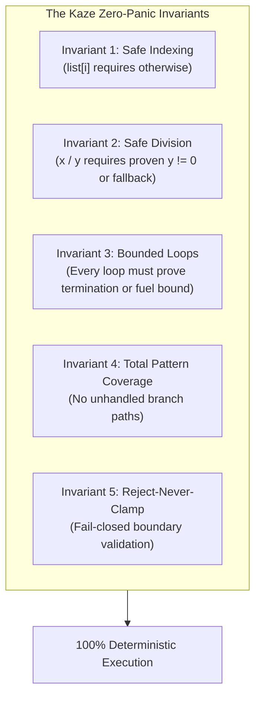

# 01. Core Philosophy & The Zero-Panic Model

> **Status:** Architecture Specification  
> **Goal:** Eliminate all runtime panics, undefined behaviors, and unexpected failure modes so that a compiled program is guaranteed to run reliably in an absolute sense.

---

## 1. Why Rust is Not Strict Enough

Rust revolutionized systems programming by preventing data races and memory corruption through its borrow checker. However, Rust deliberately stops short of proving operational correctness at compile time:

```rust
// Rust compiles this without warnings, but it CRASHES at runtime:
let items = vec![10, 20];
let val = items[5];            // PANIC: index out of bounds

let divisor = 0;
let res = 100 / divisor;       // PANIC: attempted to divide by zero

let opt: Option<i32> = None;
let x = opt.unwrap();          // PANIC: called unwrap on None

while true { ... }             // HANGS: infinite loop drains CPU indefinitely
```

In robotics, autonomous drones, edge microcontrollers, and financial systems, **a runtime panic is as catastrophic as a segfault**. A drone cannot "panic and unwrap" at 50 meters altitude; a medical ventilator cannot throw an unhandled exception.

**Kaze's Core Philosophy:** If an operation can fail at runtime, the compiler **must refuse to compile** until the developer explicitly accounts for that failure or proves mathematically that the failure cannot happen.

---

## 2. The Zero-Panic Invariants

Kaze enforces five non-negotiable operational invariants:



---

## 3. Invariant 1: Safe Indexing with Mandatory Fallback

In traditional languages, accessing `list[index]` is an implicit assertion that `index < length`. When that assumption fails, the process crashes.

In Kaze:
1. **Unbounded Indexing Requires `otherwise`:**
   ```kaze
   let item = list[i] otherwise default_val
   ```
   If `i >= length of list`, the expression evaluates cleanly to `default_val`. No crash, no panic.

2. **Compile-Time Proven Indexing:**
   If the compiler can statically prove that `i < length` (for example, inside a `for each i in 0..length` loop or after an explicit length check), the `otherwise` clause is omitted with zero runtime overhead:
   ```kaze
   if i < length of list:
       let item = list[i]   # Proven safe: compiler allows direct access
   ```

3. **Compiler Refusal:**
   Writing bare `let item = list[i]` without prior static proof or an `otherwise` branch produces:
   ```text
   Error: E_KAZE_UNSAFE_INDEX: list access at line 14 may be out of bounds.
   Fix: Provide an explicit fallback: 'list[i] otherwise <fallback>'
        or check bounds first: 'if i < length of list:'
   ```

---

## 4. Invariant 2: Non-Zero Division & Finite Arithmetic

Floating-point and integer math in Kaze never produce silent `NaN` propagation, infinity traps, or runtime panics.

1. **Division Safety:**
   Dividing by an unconstrained variable requires static proof or a fallback:
   ```kaze
   let avg = total / count otherwise 0
   ```
2. **Compile-Time Range Proof:**
   If `count` is typed with a positive contract (`count: num > 0`), the division is proven safe and compiles directly:
   ```kaze
   action compute_average(total: num, count: num between 1 and 1000):
       return total / count   # Proven safe at compile time
   ```

---

## 5. Invariant 3: Bounded Execution & Termination Invariants

Runaway while-loops and unbounded recursions cause frozen agents and deadlocked hardware. Kaze eliminates infinite execution vectors:

1. **Finite Iteration over Collections:**
   `for each item in list:` is guaranteed to terminate in finite steps equal to `length of list`.
2. **Bounded While Loops:**
   `while` loops must either have a provably decreasing metric or specify a fuel/tick bound:
   ```kaze
   while battery > 20% max 500 ticks:
       patrol_perimeter()
   otherwise:
       return to launch
   ```
3. **Execution Fuel:**
   Standalone and embedded execution runs under a fuel quota. Even if complex computation takes longer than expected, the VM halts deterministically at fuel exhaustion rather than hanging the CPU.

---

## 6. Invariant 4: Reject-Never-Clamp & Fail-Closed

A dangerous pattern in some systems is "clamping" invalid data (e.g., if a drone motor is commanded to $-500$ RPM, clamping it to $0$ RPM). Clamping masks software bugs and causes erratic physical behavior.

Kaze mandates **Reject-Never-Clamp**:
* Out-of-bounds parameters reject immediately with a structured diagnostic error.
* If a contract is violated, the function **fails closed** before any physical effect, motor pulse, or network packet is emitted.

---

## 7. Implementation & Verification Milestones

- [ ] **W1.1:** Add AST and parser support for `list[idx] otherwise default` syntax in human and machine forms.
- [ ] **W1.2:** Implement checker validation enforcing `otherwise` on unproven index expressions.
- [ ] **W1.3:** Implement compile-time range propagation in `checker.rs` and `kaze/compiler/parser.kaze`.
- [ ] **W1.4:** Add division-by-zero static verification in `checker.rs`.
- [ ] **W1.5:** Add bounded loop `max <N> ticks/fuel` syntax and bytecode checkpoints.
