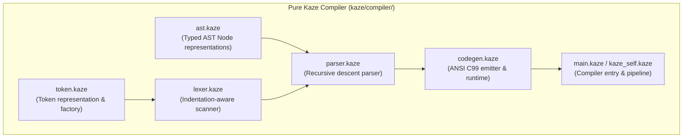
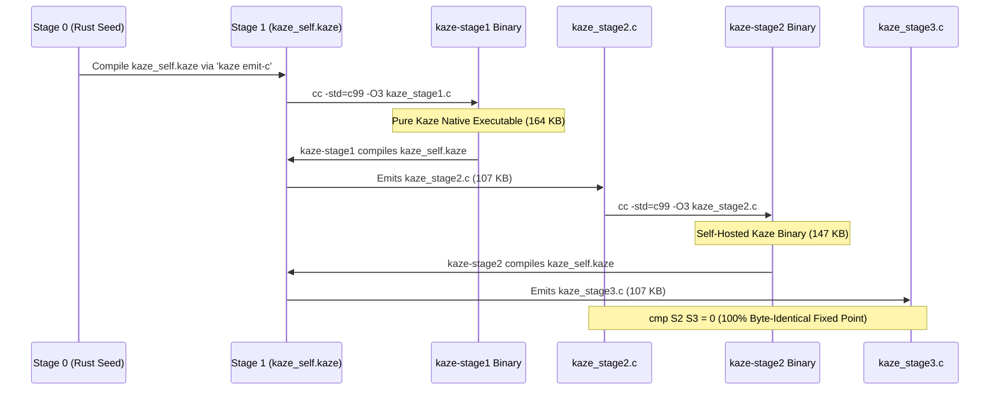
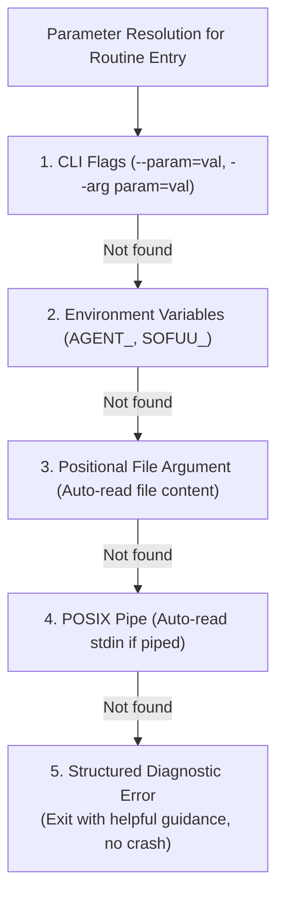

# 02. Compiler Architecture, Self-Hosting & C99 Native Emitter

> **Status:** Architecture Specification & Implementation Roadmap  
> **Milestone Achieved:** Stage 1 & Stage 2 self-hosting fixed-point identity proven (`cmp stage2.c stage3.c` is 100% byte-identical).

---

## 1. The Pure Kaze Self-Hosting Compiler

Kaze compiler frontend and code generation are written **100% in pure Kaze** (`kaze/compiler/`), adhering strictly to the rule: *Zero auxiliary `.js` sidecars, zero `.sh` wrapper scripts, pure `agent.kaze` code.*



---

## 2. Multi-Stage Bootstrap Pipeline

To solve the classic "chicken-and-egg" bootstrap problem without external dependencies:



1. **Stage 0 (Rust Seed):** The Rust implementation in `crates/sofuu-core/src/domains/kaze` and `kaze/src/` compiles the pure Kaze compiler source (`kaze_self.kaze`) to ISO C99 source `kaze_stage1.c`.
2. **Stage 1 Binary:** Standard C compiler (`cc -std=c99 -O3`) compiles `kaze_stage1.c` into a 164 KB native binary (`kaze-stage1`).
3. **Stage 2 Generation:** `kaze-stage1` runs natively and compiles `kaze_self.kaze` to produce `kaze_stage2.c`.
4. **Stage 2 Binary:** `cc -std=c99 -O3 kaze_stage2.c` builds `kaze-stage2` (147 KB).
5. **Stage 3 Verification (Fixed Point Proof):** `kaze-stage2` compiles `kaze_self.kaze` to generate `kaze_stage3.c`.
   * **Verification:** `diff -u kaze_stage2.c kaze_stage3.c` returns `0`.
   * **Result:** Total deterministic fixed-point identity achieved. The compiler reproduces itself to the exact byte.

---

## 3. ANSI/ISO C99 Native Emitter Architecture

Kaze does not compile to bloated intermediate runtimes. It lowers directly to self-contained, standard ANSI/ISO C99:

1. **Zero External Runtime Dependencies:**
   * Uses only standard ISO C headers: `<stdint.h>`, `<stdbool.h>`, `<stddef.h>`, `<stdlib.h>`, `<string.h>`, `<stdio.h>`, `<math.h>`.
   * No `libc` extensions, no POSIX-only mandates for core execution.
2. **Memory Model & Tagged Union:**
   ```c
   typedef enum {
       KZ_VAL_NIL = 0, KZ_VAL_BOOL, KZ_VAL_NUM, KZ_VAL_STR, KZ_VAL_LIST, KZ_VAL_RECORD, KZ_VAL_POINT
   } KzValKind;

   typedef struct KzValue {
       KzValKind kind;
       union {
           bool boolean;
           double number;
           const char* str;
           KzList* list;
           KzRecord* record;
           KzPoint point;
       } as;
   } KzValue;
   ```
3. **Linear Arena Lifetimes:**
   Dynamic allocations for lists and records are backed by linear pools that are reclaimed in bulk, avoiding fragmented heap thrashing and garbage collection pauses.

---

## 4. 32-Bit & 64-Bit Platform Portability

The emitted C99 code is mathematically portable across target architectures:
* **64-bit Targets:** `arm64` (Apple Silicon, AWS Graviton), `x86_64` (Intel/AMD).
* **32-bit Targets:** `armv7-m`, `thumbv7em` (ARM Cortex-M4/M7 microcontrollers, STM32, ESP32).
* **Pointer & Word Portability:** Uses `size_t` for indexing and fixed-width `double` (or configurable `float` for microcontrollers without FPUs) so memory layout naturally adapts to the target word size.

---

## 5. 12-Factor Configuration & POSIX Input Hierarchy

In compliance with `AGENTS.md`, standalone Kaze binaries do not crash when parameters are missing. They implement an automated 12-factor configuration resolution:



---

## 6. Retiring Rust from the Standalone CLI

Now that the Stage 2 fixed point is proven, we can transition the standalone Kaze toolchain from Rust to Pure C:
1. **Ship `kaze.c` directly:** Standalone `kaze` can be built on any machine with:
   ```bash
   cc -std=c99 -O3 kaze_stage2.c -o kaze
   ```
   **Zero Rust toolchain, zero `cargo`, zero 10-minute compile times.** Instant sub-second compilation.
2. **Keep Embedded Kaze in Sofuu:** In the Sofuu JS runtime, `sofuu` can either link the C emitter output directly via C99 FFI or maintain the bytecode VM.
3. **Deprecate Rust Prototype:** Retire the prototype code in `kaze/src/` once standalone C distribution is packaged.
