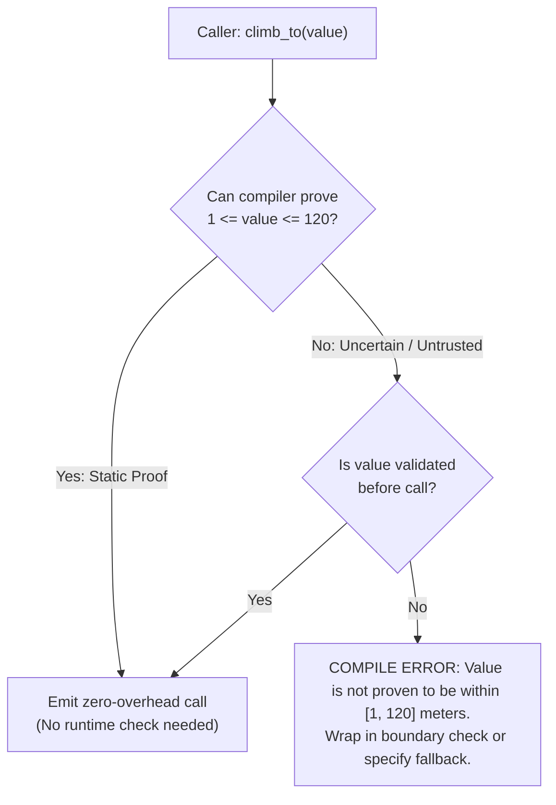

# 04. Routine Contracts, Numeric Bounds & Untrusted Boundaries

> **Status:** Architecture Specification (Workstreams W1 & W4)  
> **Core Objective:** Enable developers and AI agents to express exact pre/post-conditions and validate untrusted external data before it enters application logic.

---

## 1. Why Contracts are Essential

In conventional software, function parameters are loosely typed (e.g., `alt: f64`). However:
* Can `alt` be negative?
* Can `alt` be $10,000$ meters?
* Can `alt` be `NaN` or `Infinity`?

Without explicit contracts, safety checks are scattered across thousands of lines of ad-hoc `if` statements, or worse, forgotten entirely.

**Kaze Contracts:** Make intent part of the routine signature. The compiler checks contracts statically when possible, and enforces them at the boundary when data comes from the external world.

---

## 2. Routine Range Contracts (Workstream W1)

A Kaze routine can specify exact finite numeric bounds directly in its parameter list:

```kaze
# Range contract: alt must be between 1 and 120 meters
action climb_to(alt: num between 1 and 120 meters):
    drone.climb(to: alt)
```



### Static Verification Examples:
```kaze
action main():
    climb_to(50 meters)      # COMPILES: 50 is statically known to be in [1, 120]
    
    climb_to(150 meters)     # COMPILE ERROR: 150 exceeds upper bound 120 meters
    
    climb_to(-5 meters)      # COMPILE ERROR: -5 is below lower bound 1 meter
```

---

## 3. Untrusted Border Validation (Workstream W4)

Data arriving from external sources (HTTP requests, hardware sensors, serial links, or AI tool calls) is inherently **untrusted**.

Kaze enforces a strict type boundary: **external data enters as `untrusted` and cannot be passed to contracted routines without schema validation.**

```kaze
# Schema for external telemetry
schema SensorPayload:
    temp: num between -40 and 85 celsius
    humidity: num between 0 and 100 percent
    valid: bool

action handle_incoming_packet(raw_bytes: str):
    # Validating untrusted data at the border:
    let packet = SensorPayload.validate(raw_bytes) otherwise:
        log warning "Malformed sensor packet received; dropping."
        return

    # 'packet' is now a validated SensorPayload with guaranteed ranges
    adjust_climate(packet.temp, packet.humidity)
```

### Invariants:
1. **No Silent Type Coercion:** If an external field is missing or has the wrong type, it fails immediately. It never silently coerces strings to numbers or nulls to zeros.
2. **Fail-Closed by Design:** If validation fails, execution diverts to the `otherwise:` fallback block. The untrusted data is quarantined.

---

## 4. Null & Nil Absolute Safety

Kaze eliminates `NullPointerException` and unexpected `nil` panics:
* **Default Non-Nullable:** All variables, record fields, and routine parameters are non-nullable by default.
* **Explicit Optionals:** If a value can be absent, it must be declared as `optional T`.
* **Mandatory Unwrapping:** Accessing an `optional` value requires an explicit fallback or guard:
  ```kaze
  let result: optional num = find_target()

  # Must unwrap safely:
  let final_target = result otherwise 0
  ```

---

## 5. Result Envelope (Workstream W2)

When Kaze checks contracts and properties, it reports results using a standardized, machine-readable outcome matrix:

| Outcome | Meaning | Consequence |
| :--- | :--- | :--- |
| `statically_established` | Mathematical proof that the contract holds under all conditions. | Zero runtime check emitted; 100% safe. |
| `runtime_enforced` | Boundary check inserted at the entrance of the routine. | Validated once at the boundary; fails closed if violated. |
| `not_established` | The property cannot be proven or enforced. | **Compiler refuses execution** until the developer or AI resolves the ambiguity. |
| `violated` | Definite contradiction detected (e.g. passing 150 to a max-120 contract). | Compile error with exact line, column, and fix instructions. |

---

## 6. Implementation Milestones

- [ ] **W1.ContractAST:** Add `between <min> and <max>` AST representations to routine parameter nodes.
- [ ] **W1.StaticBounds:** Implement static constant bounds checking in `checker.rs` and `kaze/compiler/parser.kaze`.
- [ ] **W4.Schema:** Introduce `schema Name:` declaration and `.validate()` border parsing.
- [ ] **W2.Diagnostics:** Standardize error codes (`E_KAZE_CONTRACT_VIOLATION`, `E_KAZE_UNVALIDATED_BORDER`).
