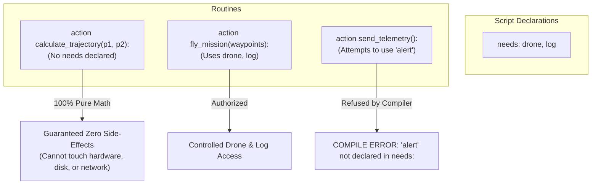

# 05. Capability-Based Security & Hermetic Effect Envelopes

> **Status:** Architecture Specification  
> **Core Objective:** Eliminate unauthorized side-effects and establish zero-ambient-authority security for embedded, autonomous, and AI systems.

---

## 1. Zero-Ambient-Authority Model

In conventional languages (C, Python, Rust, Node.js), **any function in any library can do anything**:
* A math library can secretly open a socket and exfiltrate data.
* A logging function can silently write files or execute shell commands.
* An AI agent script can call `system("rm -rf /")` if it gets access to standard libraries.

**Kaze enforces Zero-Ambient Authority:**
A routine has **zero access to the outside world** unless explicitly granted authority in the script's header.



---

## 2. 100% Pure Functions by Default

Any routine in Kaze that does not invoke an authorized capability is **mathematically pure**:
* **Referentially Transparent:** Given the same inputs, it always returns the exact same output.
* **Zero I/O:** Cannot read time, cannot access random numbers, cannot touch hardware, cannot allocate unmanaged memory.
* **Free from Deadlocks & Race Conditions:** Pure routines can be parallelized across any number of CPU cores without locks.

---

## 3. Monotonic `needs:` Capability Grants

To interact with physical hardware, system resources, or network tools, a script must declare its capability families in its header:

```kaze
needs: drone, sensor, log
```

### The Closed Capability Families:
| Family | Instance Aliases | Permitted Operations |
| :--- | :--- | :--- |
| `drone` | `uav`, `quad` | `arm`, `disarm`, `takeoff`, `land`, `fly to`, `return to launch` |
| `rover` | `ugv`, `car` | `drive forward`, `turn left`, `turn right`, `stop` |
| `sensor` | `lidar`, `camera`, `thermostat`, `probe` | Read-only telemetry (`front_distance`, `temperature`, `humidity`) |
| `device` | `fan`, `mister`, `pump`, `relay`, `valve`, `motor`, `light` | Physical effectors (`turn on`, `turn off`, `pulse for N seconds`) |
| `memory` | `cma`, `brain` | Semantic memory read/write (`remember`, `recall`) |
| `policy` | `guardrail` | Security and safety rule checks (`allow`, `reject`) |
| `log` | `logger` | Local diagnostic logging (`log info`, `log warning`, `log error`) |
| `alert` | `alarm` | Critical notifications and alerts (`send alert`) |
| `ai` | `model`, `llm`, `agent` | Controlled inference queries |
| `tool` | `mcp`, `tools` | Authorized external MCP tool invocations |

---

## 4. Fine-Grained Effect Envelopes

Declaring a capability does not give blanket access. The compiler checks every individual verb against the capability arity and permission table:

```kaze
needs: sensor, log

action scan_room():
    log "Scanning room temperature..."
    let t = sensor.temperature()
    if t > 35 celsius:
        turn on fan   # COMPILE ERROR: 'fan' is a device; requires 'needs: device'
        arm drone     # COMPILE ERROR: requires 'needs: drone'
```

### Safety Rules:
1. **No Transitive Leakage:** If module A imports module B, module B cannot use capabilities that module A did not explicitly grant.
2. **Fail-Closed Gatekeeper:** If a capability is denied at runtime (e.g. policy rejection or disconnected hardware link), execution diverts to failsafe handlers immediately.
3. **Physical State Pre-Conditions:** Effectors enforce hardware state machines (e.g., `drone.takeoff()` is statically rejected if `arm drone` was not previously issued).

---

## 5. 12-Factor Governance & Zero Auxiliary Wrappers

Per project governance (`AGENTS.md`):
* Agents are **100% pure Kaze** (`agent.kaze`).
* Zero `.sh` shell script wrappers, zero auxiliary `.js` sidecars.
* Input data enters cleanly via generic CLI arguments (`--arg`), standard POSIX pipes, or authorized MCP tools.

---

## 6. Implementation Milestones

- [ ] **W4.Effects:** Formalize effect summaries in `caps.rs` and `kaze/compiler/codegen.kaze`.
- [ ] **W4.Purity:** Implement compile-time purity verification for routines that do not declare capability effects.
- [ ] **W4.Monotonic:** Verify that imported libraries cannot elevate authority beyond the root script's `needs:` declarations.
- [ ] **W4.Policy:** Connect capability execution gates directly to fail-closed hardware policies.
