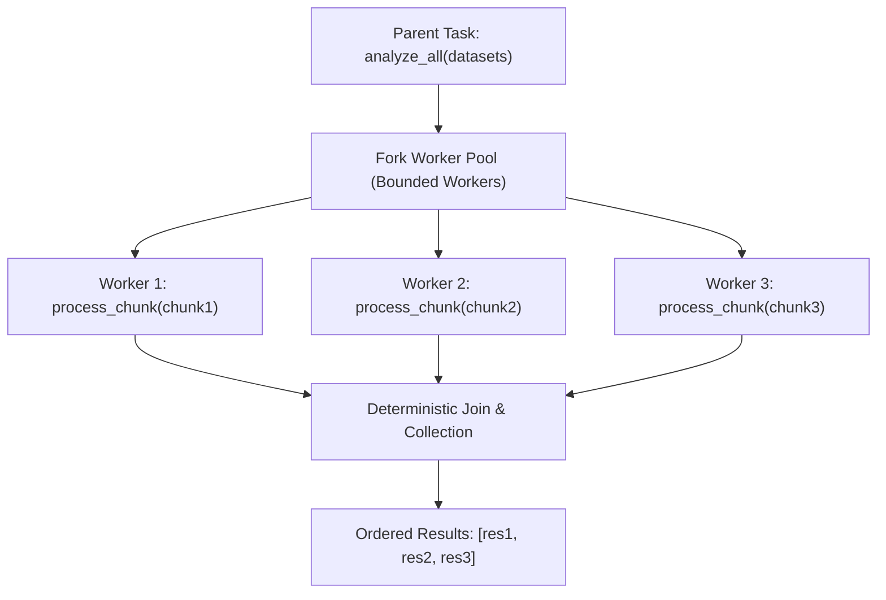

# 06. Bounded Concurrency & Deterministic Parallelism

> **Status:** Architecture Specification (Workstream W5)  
> **Core Objective:** Provide safe, high-throughput concurrency for multi-core edge systems and robots without data races, deadlocks, or unbounded thread spawning.

---

## 1. The Concurrency Dilemma in Systems Programming

Concurrency in C, C++, and Go introduces catastrophic bugs:
* **Data Races:** Multiple threads reading and writing shared memory without synchronization.
* **Deadlocks:** Mutex locks acquired in inconsistent order.
* **Unbounded Resource Exhaustion:** Thread pools spawning thousands of OS threads, crashing the system with Out-Of-Memory (OOM).
* **Nondeterminism:** Code that passes 99 times and crashes on the 100th run due to timing jitter.

**The Kaze Model:** Concurrency is divided into two mathematically distinct domains:
1. **Pure Concurrency (W5a):** Embarrassingly parallel pure calculations that are provably race-free and deterministic.
2. **Effectful Concurrency (W5b):** Serialized, capability-checked interactions with physical hardware and external tools.

---

## 2. W5a: Explicit Pure Concurrency (Fork-Join)

Because routines without capabilities are 100% pure (free from side-effects and shared mutable state), they can be evaluated concurrently with zero mutexes and zero locks:



### Syntax Design:
```kaze
action process_chunks(chunks: list):
    # Pure parallel mapping with explicit worker bound:
    let results = parallel map c in chunks with max 4 workers:
        compute_features(c)
    return results
```

### Invariants of Pure Parallelism:
1. **Deterministic Ordering:** Results are always collected in the exact order of the input collection, regardless of which CPU worker finishes first.
2. **Zero Shared Mutable State:** Workers receive immutable slices or deep copies; writing to shared variables is prohibited at compile time.
3. **No Hidden Effects:** The compiler rejects any routine inside a `parallel` block that invokes a capability (`drone`, `device`, `alert`).

---

## 3. Resource-Bounded Child Tasks (Fuel & Memory Caps)

To prevent denial-of-service on embedded microcontrollers:
* **Parent Budget Inheritance:** If a parent task has 10,000 fuel units, its concurrent children share or divide that budget. The sum of child allocations cannot exceed the parent limit.
* **Bounded Worker Pool:** Standalone Kaze limits concurrency to the number of physical hardware cores (e.g., 4 on an ARM Cortex-A53), avoiding OS context-switch thrashing.
* **Timeout & Deadline Propagation:** If an operation has a deadline of $500\text{ ms}$, all child tasks are canceled immediately upon deadline expiration.

---

## 4. W5b: External Effects & Hardware Serialization

Physical hardware cannot be accessed concurrently:
* Two threads cannot simultaneously tell a drone to `turn left` and `turn right`.
* Two tasks cannot simultaneously pulse a GPIO pin.

In Kaze:
* **Single Physical Driver:** Every capability family operates over a serialized hardware channel.
* **Non-Blocking Supervised Ticks:** Hardware supervision runs on deterministic ticks:
  ```kaze
  every 100ms:
      let dist = lidar.front_distance()
      if dist < 0.5 meters:
          stop rover
  ```
* **Explicit Asynchronous Handlers:** External network or AI queries use explicit asynchronous channels with timeout contracts, never blocking the physical supervisor loop.

---

## 5. Implementation Milestones

- [ ] **W5.PureCheck:** Implement compile-time pure task classification in `checker.kaze`.
- [ ] **W5.ForkJoin:** Add thread pool / worker dispatch in the C99 native runtime.
- [ ] **W5.FuelAccounting:** Divide parent execution fuel across concurrent worker tasks.
- [ ] **W5.HardwareLock:** Enforce serialized single-writer access to physical effectors.
