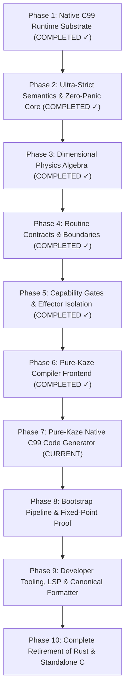

# Kaze Language Master Plan: The Ultra-Strict Systems Language

> **The Core Maxim:** *"If it compiles, it runs without problems in an absolute sense."*  
> **Master Roadmap:** [00-DETAILED-MASTER-ROADMAP.md](./00-DETAILED-MASTER-ROADMAP.md) (Detailed 10-Phase Dependency-Ordered Execution Guide)

Kaze is a next-generation systems programming language designed for deterministic agents, robotics, edge embedded computing, and trustworthy AI-driven software. It pairs **high-level, sentence-like human syntax** with **low-level, zero-overhead C/C++ execution performance**, backed by compile-time safety that exceeds Rust.

---

## 1. Vision & Architectural Pillars

Most modern languages force a painful trade-off:
* **C / C++:** Blazing speed and direct hardware control, but plagued by segfaults, buffer overflows, undefined behavior, and silent memory corruption.
* **Rust:** Memory safety without garbage collection, but permits runtime panics (`unwrap()`, array out-of-bounds, divide-by-zero), infinite loops, unbounded recursion, and heavy lifetime syntax (`<'a, T>`).
* **Python / JavaScript:** High developer velocity, but slow, untyped, unpredictable runtime crashes, and prone to AI hallucinations.

**Kaze rejects this compromise.** 

Kaze provides:
1. **Human Clarity:** Sentence-like readable syntax (`action`, `check`, `otherwise:`, `length of x`, `needs: drone, log`).
2. **Absolute Reliability:** Mathematical proof at compile time that the program cannot crash, panic, overflow, index out of bounds, or divide by zero.
3. **C/C++ Speed & Small Footprint:** Self-hosting pure Kaze compiler emitting clean, standalone ISO C99 yielding tiny native binaries executing with microsecond latency.
4. **Physical World Safety:** First-class physical units (`meters`, `m/s`, `ms`, `degrees`, `percent`) verified with compile-time dimensional algebra.
5. **AI Gatekeeper Architecture:** Strict hermetic contracts that turn the compiler into an infallible verifier for AI-generated code.

---

## 2. Modular Master Plan Index

To maintain modularity and deep architectural rigor, the Kaze roadmap is divided into dedicated sub-plans:

| Document | Topic | Key Focus Areas |
| :--- | :--- | :--- |
| [**00. Master Detailed Roadmap**](./00-DETAILED-MASTER-ROADMAP.md) | **Phase-by-Phase Execution Guide** | Comprehensive 10-phase execution roadmap, acceptance gates, zero timelines, dependency matrix. |
| [**01. Core Philosophy & Strictness**](./01-CORE-PHILOSOPHY-AND-STRICTNESS.md) | **Zero-Panic & Total Reliability** | Eliminating runtime panics, safe indexing (`otherwise`), non-zero math, guaranteed loop termination, fail-closed design. |
| [**02. Compiler & Self-Hosting**](./02-COMPILER-AND-SELF-HOSTING.md) | **Self-Hosting Pipeline & C99 Emitter** | Pure Kaze compiler (`lexer`, `parser`, `ast`, `codegen`), Stage 1/2/3 fixed-point proof, 32-bit & 64-bit portability, retiring Rust. |
| [**03. Type System & Physics Units**](./03-TYPE-SYSTEM-AND-UNITS.md) | **Linear Typing & Dimensional Units** | Linear ownership without lifetime sigils, arena scoping, dimensional physics algebra (`meters / seconds = m/s`), compile-time unit checking. |
| [**04. Contracts & Boundary Safety**](./04-CONTRACTS-AND-BOUNDARIES.md) | **Pre/Post-Conditions & Untrusted Inputs** | Routine range contracts (`between 0 and 120`), untrusted input sanitization at borders, null/nil elimination, invariant checking. |
| [**05. Capabilities & Effect Envelopes**](./05-CAPABILITIES-AND-EFFECTS.md) | **Zero-Ambient Authority Security** | 100% pure functions by default, monotonic `needs:` capability grants, fine-grained effect summaries, hardware isolation. |
| [**06. Concurrency & Parallelism**](./06-CONCURRENCY-AND-PARALLELISM.md) | **Deterministic Bounded Parallelism** | Pure fork-join concurrency, resource-bounded child tasks (fuel & memory caps), serialized physical effects. |
| [**07. AI Workflow & Verifier**](./07-AI-WORKFLOW-AND-VERIFIER.md) | **AI Proposal & Autonomous Repair** | Compiler-as-a-verifier, structured machine-readable diagnostics, AI self-repair loops, reviewable intent. |
| [**08. Tooling, LSP & Ecosystem**](./08-TOOLING-LSP-AND-ECOSYSTEM.md) | **Developer Experience & Tooling** | Dual syntax (human sentence $\leftrightarrow$ machine S-expr), Language Server Protocol (LSP), formatter, test runner, module loader. |
| [**09. Native AI Models & Tensors**](./09-NATIVE-AI-MODELS-AND-TENSORS.md) | **Tensors, Autograd & Model Training** | First-class tensor types, compile-time shape algebra, zero-GC arena tensors, symbolic autograd, SIMD/Metal GPU lowering. |

---

## 3. High-Level Structured Phases

> For detailed component manifests, algorithms, error codes, and acceptance gates, see [00-DETAILED-MASTER-ROADMAP.md](./00-DETAILED-MASTER-ROADMAP.md).

* **Phase 1: Native Systems Foundation & C99 Runtime (COMPLETED ✓)**: Portable ANSI C99 runtime header (`kaze_rt.h`, `kaze_rt.c`), linear bump arena memory management with zero GC, checked arithmetic primitives, and 32-bit & 64-bit type abstractions. Passed 1,000,000 arena cycles under ASan/UBSan without leaks.
* **Phase 2: Ultra-Strict Semantics & Zero-Panic Core (COMPLETED ✓)**: Mandatory `otherwise` fallbacks on all fallible operations (division, modulo, array bounds, map lookups), bounded loop proofs, recursion ceilings ($\le 256$), and structured visual caret diagnostics. 72 fixtures verified.
* **Phase 3: Compile-Time Dimensional Physics Algebra (COMPLETED ✓)**: First-class dimensional units (`meter`, `second`, `rad`, `deg`, `Celsius`, `mbar`, etc.) across 22 unit spellings verified statically via compile-time dimensional algebra and lowered with zero runtime overhead.
* **Phase 4: Routine Contracts & Untrusted Input Boundaries (COMPLETED ✓)**: Routine preconditions (`requires`) and postconditions (`ensures`), interval arithmetic range propagation, assertion elision, and 4-tier 12-factor CLI resolution.
* **Phase 5: Capability Gates, Security Policies & Effector Isolation (COMPLETED ✓)**: Zero-ambient authority, monotonic capability attenuation, real alert sinks with credential scrubbing, unified 1500 ms robotics safety watchdogs, and async-signal-safe actuator de-assertion.
* **Phase 6: Pure-Kaze Self-Hosted Compiler Frontend (COMPLETED ✓)**: Tokenizer, dual-syntax parser (human sentence $\leftrightarrow$ machine S-expression), AST data structures, and semantic checker authored 100% in pure Kaze. Verified fixed-point identity ($\text{sha256}(s2.c) == \text{sha256}(s3.c)$) and 100+ file lossless round-trips.
* **Phase 7: Pure-Kaze Native C99 Code Generator (CURRENT / IN PROGRESS)**: AST-to-C99 lowering engine in pure Kaze emitting clean, readable, zero-GC native C code targeting `kaze_rt.h` directly with linear bump arena allocations.
* **Phase 8: Multi-Stage Bootstrap Pipeline & Fixed-Point Verification**: Stage 0 (Rust) $\to$ Stage 1 (Native C) $\to$ Stage 2 (Pure Kaze) $\to$ Stage 3 (Fixed-Point Proof) automated CI verifier.
* **Phase 9: Developer Experience, Native LSP & Canonical Formatter**: Sub-millisecond Language Server Protocol (LSP) daemon, idempotent `kaze fmt`, and unified single-binary CLI toolchain.
* **Phase 10: Complete Retirement of Rust & Standalone Distribution**: Permanent removal of Rust Stage 0 files, distributing Kaze as a self-contained, sub-second C build (`dist/kaze.c` and `dist/kaze_rt.h`).
